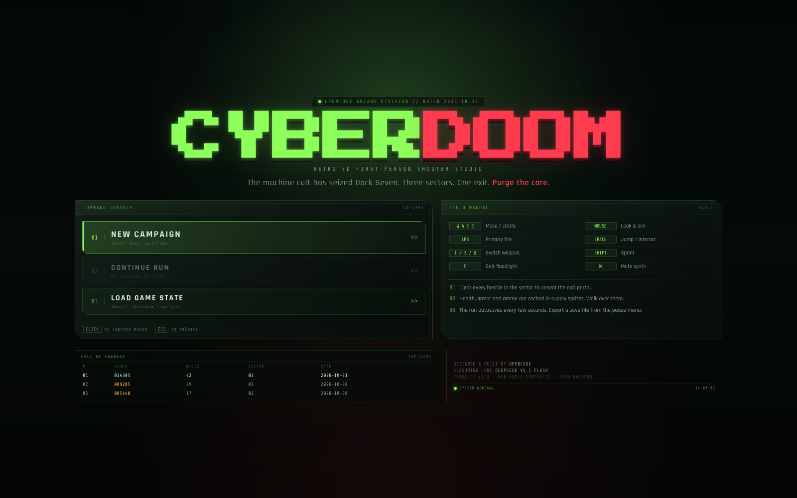
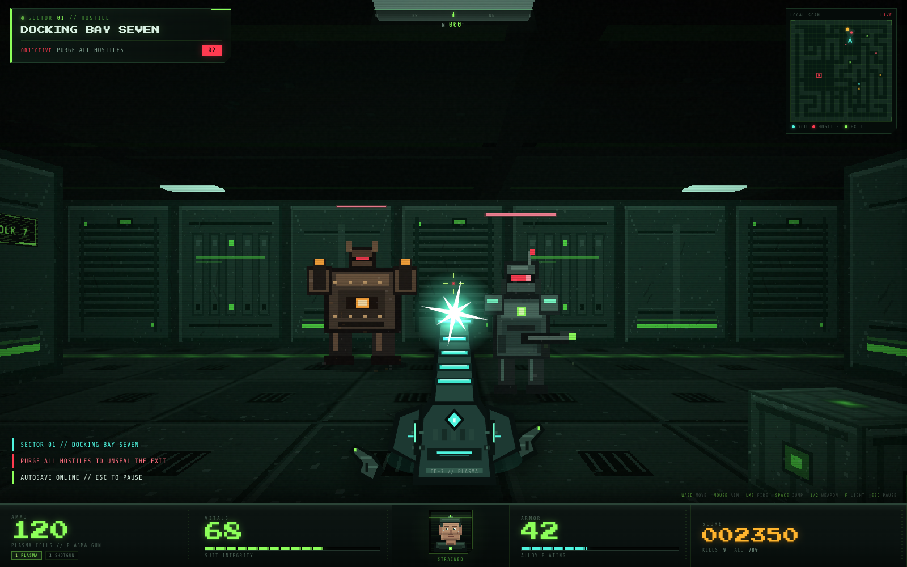
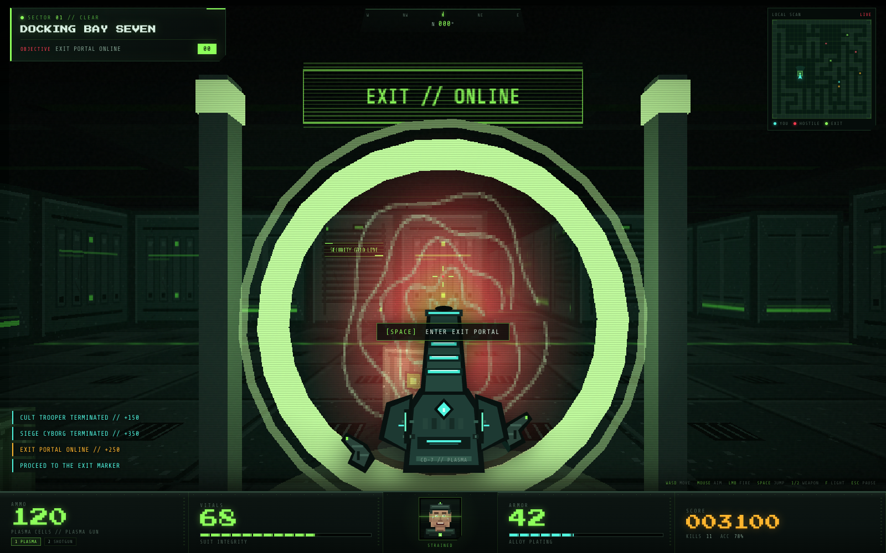
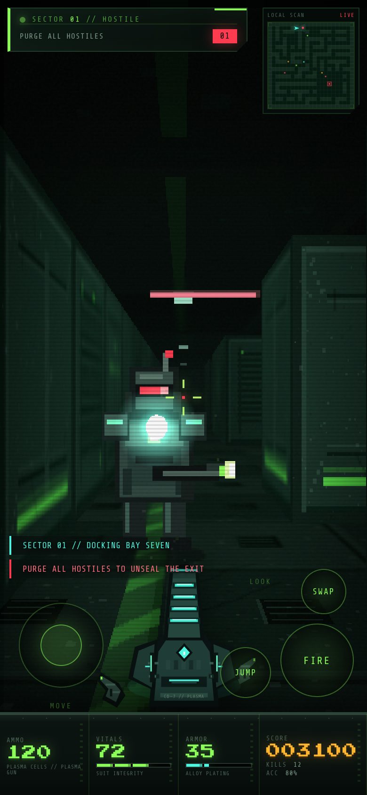
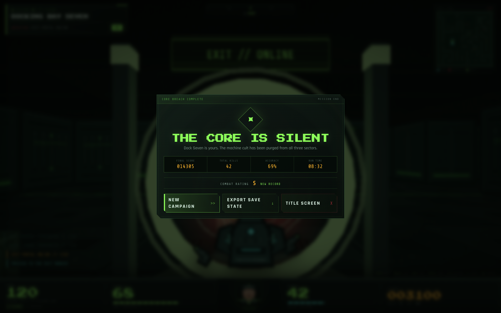

# CYBERDOOM

**Retro 3D First-Person Shooter Studio** — a complete, production-ready, 100% client-side FPS built with vanilla HTML5, CSS3, ES6 and Three.js r128.

[](https://somphol.github.io/cyberdoom-retro-fps/)
[](#)
[](#)

> The machine cult has seized Dock Seven. Three sectors. One exit. **Purge the core.**



## Overview

CYBERDOOM is a self-contained love letter to 1990s ray-caster shooters, packaged as a modern static web application. It procedurally builds three cyber-industrial sectors, populates them with billboarded cyborg enemies and supply sprites, and drives a complete combat → clear → descend loop with a Doom-style status bar, synthesised audio and JSON save transfer.

Everything runs in the browser. There is no server, no build step, no database, no API key and no image/audio asset pipeline. The wall, floor, ceiling, enemy, pickup, weapon, face and minimap art are generated at runtime with Canvas 2D. Sound effects are synthesised with the Web Audio API.

## Live demo

<https://somphol.github.io/cyberdoom-retro-fps/>

## Features

### 3D retro engine

- Three procedurally generated sectors: **Docking Bay Seven**, **Reactor Spine** and **The Cyber Core**.
- Modular grid-dungeon generator with recursive-backtracker mazes, carved rooms, braided loops, flood-fill reachability and far-room exit placement.
- Textured 3D wall blocks, concrete floor planes, ceiling planes, riveted props, barrels, server pillars, warning signage and ceiling light panels.
- PointerLockControls mouse look, WASD/arrow movement, sprint, jump, head-bob and wall/obstacle collision.
- Billboarded enemies, pickups and exit labels that always face the camera.
- Low-resolution internal render scaled with `image-rendering: pixelated`, plus scanlines, grain, vignette and CRT flicker overlays.
- Dark sci-fi lighting: fog, ambient/hemisphere light, coloured ceiling point lights, a suit floodlight and a dynamic muzzle-flash point light.
- Animated exit portal with locked/online states, dual rings, a procedural vortex and a point-light colour change.

### Combat and AI

- **Plasma Gun** and **Super Shotgun** with distinct damage, spread, pellet count, range, recoil, muzzle flash, ammo pools and procedural weapon art.
- Hitscan ray verification against enemy hitboxes with wall occlusion, range falloff and headshot detection.
- Particle hit sparks, additive tracers, muzzle flash, crosshair kick, hit markers, screen shake and damage vignette.
- Enemy state machine: `idle → patrol → alert → chase → attack → dead`.
- A* grid pathfinding, line-of-sight checks, patrol targets, alert propagation, enemy separation and wall sliding.
- Three enemy archetypes:
  - **Cult Trooper** — ranged plasma projectiles.
  - **Cyber Hound** — fast melee attacker.
  - **Siege Cyborg** — tanky triple-shot artillery.
- Projectiles collide with walls, props and the player; armour absorbs part of incoming damage.
- Full sound synthesis: plasma/shotgun reports, dry fire, weapon swap, growls, alert stings, enemy shots, hit markers, footsteps, jumps, pickups, hurt, death, portal, level-clear fanfare and victory chime.

### Status bar, saves and UI

- Classic Doom-style bottom status bar with **AMMO / VITALS / MARINE FACE / ARMOR / SCORE**.
- Animated marine portrait with six health states, blinking, eye movement, sweat, blood, gritted teeth and a kill grin.
- Minimap with walls, floor, pickups, hostiles, exit marker, scanning line, player heading and FOV wedge.
- Objective tracker, compass bearing, threat state, message feed and context prompts.
- Autosave to `localStorage` every ~4 seconds and on pause/unload.
- **💾 Save Game State** downloads `cyberdoom_save.json` with the full run, high scores and credits.
- **📂 Load Game State** imports a save file, validates every field, restores the level layout state and merges high scores.
- Hall of Carnage top-runs table persisted locally.
- Pause menu with mouse sensitivity, synth volume, render resolution and reduced-FX settings.
- Responsive layout with a virtual joystick, drag look pad, fire/jump/swap buttons for touch devices.
- Keyboard, mouse and touch support. `prefers-reduced-motion` respected.

## Screenshots

| Gameplay | Exit portal |
| --- | --- |
|  |  |

| Title screen | Mobile |
| --- | --- |
|  |  |



## Controls

| Input | Action |
| --- | --- |
| `W A S D` / arrow keys | Move and strafe |
| Mouse | Look and aim |
| Left mouse button | Fire |
| `Space` | Jump; interact with the exit portal when close |
| `1` / `2` / `Q` / mouse wheel | Switch Plasma Gun / Super Shotgun |
| `Shift` | Sprint |
| `F` | Toggle suit floodlight |
| `M` | Mute/unmute synth |
| `Esc` / `P` | Pause |
| `Enter` | Start / advance / retry on menu screens |
| Touch | Left stick moves, drag right side to look, on-screen Fire / Jump / Swap |

## Run locally

Because the page loads Three.js and PointerLockControls from a CDN and stores saves in `localStorage`, serve it over HTTP rather than opening the file directly:

```bash
cd cyberdoom-retro-fps
python3 -m http.server 8000
# open http://localhost:8000
```

No install, build, transpile or backend process is required.

## Deploy to GitHub Pages

The repository is already configured for static Pages hosting:

1. Push the repository to GitHub.
2. **Settings → Pages → Build and deployment → Deploy from a branch**.
3. Choose **`main`** and **`/ (root)`**.

`.nojekyll` is included so the site is served exactly as committed.

## Save format

`cyberdoom_save.json` is a human-readable JSON document:

```json
{
  "format": "cyberdoom-save",
  "schema": 1,
  "version": "1.0.0",
  "exportedAt": "2026-11-01T05:00:00.000Z",
  "run": {
    "level": 0,
    "seed": 1234567890,
    "player": { "x": 0, "z": 0, "health": 82, "armor": 25 },
    "weapons": {
      "current": "plasma",
      "plasma": { "ammo": 96 },
      "shotgun": { "ammo": 17 }
    },
    "stats": { "score": 2400, "kills": 9, "shotsFired": 41, "shotsHit": 28, "timePlayed": 312.4 },
    "enemies": [],
    "pickups": []
  },
  "highScores": [],
  "credits": {
    "builtWith": "OpenCode 2.2.5",
    "model": "DeepSeek V4.1 Flash (opencode-go/deepseek-v4.1-flash)",
    "engine": "Three.js r128"
  }
}
```

Import validation clamps numbers, validates level/seed/weapon/enemy/pickup types, strips markup from strings and rejects malformed payloads rather than applying partial state.

## Architecture

The entire application is three files:

| File | Responsibility |
| --- | --- |
| `index.html` | Semantic shell, title/pause/victory/game-over screens, HUD, touch controls, CDN script tags |
| `style.css` | Retro-industrial design system, HUD chrome, status bar, menus, scanlines, responsive/touch layout |
| `script.js` | Procedural art, dungeon generation, A* AI, combat, audio synthesis, HUD rendering, saves, self-tests |

Key runtime systems in `script.js`:

- `SynthEngine` — Web Audio graph, noise buffer, envelope helpers and every sound effect.
- `TextureFactory` — wall/floor/ceiling/prop/sign/enemy/pickup/glow/portal Canvas 2D art.
- `ParticleField` and `TracerPool` — pooled impact effects and hitscan tracers.
- `DungeonLevel` — maze generation, rooms, braiding, BFS distances, collision, LOS, A*, props, lights, signage and exit portal.
- `Enemy`, `Projectile`, `Pickup` — billboard entities, AI, damage and persistence.
- `HUD` — status bar, animated marine face, weapon viewmodel, minimap, messages and prompts.
- `Game` — renderer/camera/controls, player physics, combat, level flow, autosave/export/import, self-tests and the animation loop.

## Verification

Run the built-in test surface with:

```text
https://somphol.github.io/cyberdoom-retro-fps/?selftest=1
```

The self-test covers **17 checks**:

- Three.js r128 and PointerLockControls availability
- WebGL renderer creation
- Dungeon connectivity, start/exit reachability, pathfinding
- Wall collision and collision-free spawn
- Weapon, enemy and pickup configuration
- HUD DOM mounting
- Web Audio availability
- Save sanitisation round-trip and malformed-input rejection
- High-score archive readability

End-to-end headless Chrome runs verified:

- New campaign, sector generation and HUD mount
- Plasma and shotgun hitscan damage, hit sparks and kill scoring
- Player damage, armour absorption and face-state changes
- Autosave → title → continue restoration of level, ammo, health, score and enemies
- Pause/resume, save export to `cyberdoom_save.json`, real file-input import
- Exit unlock, Space interaction, level-clear overlay, sector transition through all three sectors
- Victory screen, high-score recording and persistence across reload
- Death → game-over → retry
- Settings persistence and resolution changes
- Mobile 390×844 touch layout with joystick, look pad, fire/jump/swap controls
- **0 uncaught exceptions** and **0 console errors** in the final run

Rendering statistics observed in Chrome at 1600×1000: ~194 draw calls, ~3,700 triangles, ~57 FPS in the test environment.

## Browser support

Latest Chrome, Edge, Firefox and Safari with WebGL and Pointer Lock. Touch controls are enabled on coarse-pointer devices. Audio starts after the first user gesture, as required by browser autoplay policies.

## Credits

- **Built with** [OpenCode](https://opencode.ai) **2.2.5**
- **Model** **DeepSeek V4.1 Flash** (`opencode-go/deepseek-v4.1-flash`)
- **3D engine** [Three.js](https://threejs.org/) r128 (MIT)
- **Pointer lock** [PointerLockControls](https://threejs.org/docs/#examples/en/controls/PointerLockControls) (Three.js examples, MIT)
- **Typefaces** Press Start 2P, Rajdhani and Share Tech Mono via Google Fonts (SIL OFL 1.1)
- **CDN** cdnjs (Three.js) and jsDelivr (PointerLockControls)

No third-party images, textures, audio files or 3D models are included. Every visual and sound is generated procedurally at runtime. See [THIRD_PARTY_NOTICES.md](THIRD_PARTY_NOTICES.md).

## License

MIT © 2026 Somphol Boonjing. See [LICENSE](LICENSE).
